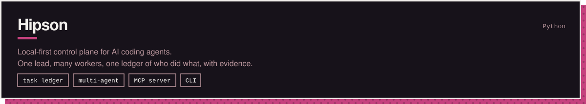
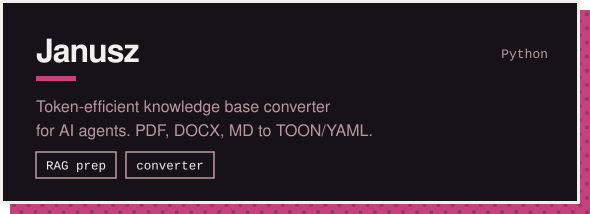
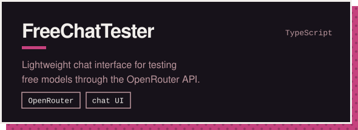

  
  
  

## About

I work where software building, AI-assisted development and workflow design meet.

I use AI tools to get from idea to a working application faster. I define the goal, prepare the context, break the work into tasks, supervise what the agents build, test the result and iterate until the workflow actually works.

> I don't treat AI as a toy or a shortcut. I treat it as an execution layer that needs direction, structure and verification.

## Projects

&nbsp;

## Toolbox

  
  
  
  
  
  
  
  
  

## Contact

The best way to reach me is [LinkedIn](https://linkedin.com/in/marcin-mortka-254883251/).
